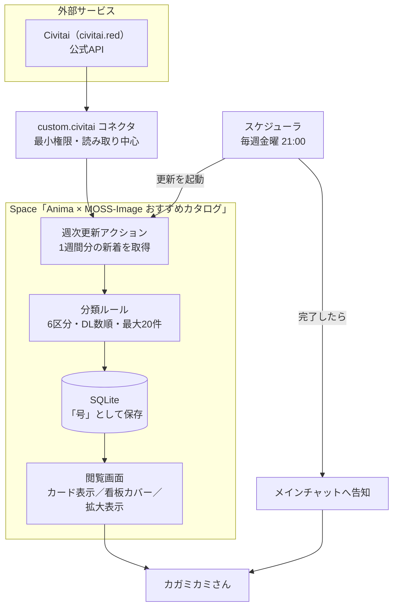

# Anima × MOSS-Image おすすめカタログ ～ 設計エッセンス

Civitai で公開される Anima / MOSS-Image 系モデルの新着を、週1回・6区分で自動収集して眺める自分用カタログ（Muse の Space）の、設計エッセンスを公開するリポジトリです。

カタログ本体は自分用ツールのため非公開です。本リポジトリでは、似たような仕組みを Muse で作りたい人向けに、構成図と「決めごと」をまとめています。

紹介記事（note）： [Anima × MOSS-Image おすすめカタログを作った ～ 週1回、新着を6区分で眺める自分用の置き場](https://note.com/kagami_kami/n/nb8dde559d6d0)

## 全体の構成

（同じ図の単体ファイル： [diagram.mmd](./diagram.mmd)）

流れはシンプルです。Civitai 公式API → 最小権限のコネクタ → Space 内の更新アクション → 分類ルール → データベースに「号」として保存 → 閲覧画面。ここに外側のスケジューラが加わり、決まった時刻に更新を起動して、終わったらチャットに告知します。Space の中だけで全部を抱え込まないのがポイントです。

## 設計のキモは4つ

### 1. データ取得は、公式APIと最小権限のコネクタに分離する

表示や保存の仕組みと、外部からデータを取ってくる部分は分けます。取得側は公式APIだけを使い、権限は読み取り中心の必要最小限に絞る。API側の仕様が変わったときも直す場所が少なく済みますし、「どこまで許可しているか」も説明しやすくなります。

このカタログでは、生成に関わる機能だけ例外として書き込み可にし、消費する Buzz には24時間あたり200 Buzz の上限を設定しています。運用は「権限はあるが、基本は使わない。使うときは都度相談」です。

### 2. 「号」という単位で、スナップショットをデータベースに貯める

毎回作り直すのではなく、1週間分を1つの「号」としてデータベース（SQLite）に保存します。過去の号が残るので見返すことができますし、「今週分だけ更新する」という運用も自然にできます。履歴を残したいものは、最初から保存の単位を決めておくのが大事です。

### 3. 分類は気分ではなく、ルール判定に寄せる

区分は6つ： Anima チェックポイント / Anima LoRA（LyCORIS・DoRA を含む）/ MOSS チェックポイント / MOSS LoRA / その他チェックポイント / その他（ControlNet・VAE・ワークフローなど）。

ポイントは、名前や雰囲気ではなくベースモデルで分けることです。Anima ベースのみ Anima 区分へ、それ以外のベース（Qwen や Krea2 など）はその他チェックポイントへ回します。「何を見て、どこへ入れるか」を言葉で書けるルールにしておくことが、そのまま品質になります。

### 4. 定期実行は外側のスケジューラから叩き、終わったらチャットに告知する

更新の起動は Space の外のスケジューラに任せます（このカタログでは毎週金曜21時、集計範囲は前週金曜21:00～今週金曜21:00）。中の仕組みは「頼まれたら1回分を正しく作る」ことに集中させ、外側が「いつ動かすか」と「終わったことを伝えるか」を持ちます。止まったときも、どこで止まったかが分かりやすくなります。

## 見せ方の設計メモ

### サムネイル選定と R18 の見せ方

- サムネイルは正方形（1:1）。横長だと人物の顔が見切れるため
- サムネイルは最大4枚。R18ではない画像を優先して選び、後ろの方にある通常画像も繰り上げる
- 通常画像が足りず R18 画像がサムネイルに残る場合は、サムネイル列の最後の枠を「NSFW!」看板カードにして、NSFW 画像が含まれることを明示する
- 選んだサムネイルがすべて R 以上になるモデルは、カード全体を看板カバーで覆い、タップで初めて表示する
- もともと画像が4枚に満たないモデルでは、看板カードは出さない
- 全体表示（タップ時）は4枚制限がなく、そのモデルの全画像を表示する。動画の作例は最初のフレームを画像にしてサムネイルに使い、全体表示では動画として再生する

### プレビュー画像のキャッシュ

- プレビュー画像は、号を作るタイミングでカタログ内に取り込んで保存する（長辺800px・WebP 品質60に変換）。元の置き場のリンクが切れても一覧が崩れず、遅い回線でも快適に表示できる
- 取り込みが1回の実行時間に収まらない場合は、残りをバックグラウンドで自動的に最後まで作成する（手動操作に依存しない）
- キャッシュの保持は直近5号分まで。古い号は元の画像へのリンク表示に戻る

### Hugging Face 枠は別タブに分離

- Civitai とは別のプラットフォーム（Hugging Face Hub）の新着は、6区分に混ぜず、画面上部の別タブに分けた。検索のノイズの多さ、「新着」やダウンロード数の意味の違い、サムネイルの性質の違いを、本体側の分類ルールの純度と切り離すため
- 取得は Hugging Face Hub の公開API。検索語「anima」「MOSS」に画像生成（text-to-image）タグの絞り込みをかけ、モデルの作成日時で同じ1週間の窓を判定し、Civitai 側と同じ「号」に保存する（重複はモデルIDで除去、最大20件・新しい順）。過去の号を選ぶと HF タブもその号の内容に切り替わる
- サムネイルはモデルカード（README）で使われている最初の画像を、そのままの縦横比で表示する。画像が無いモデルには、ちびキャラのプレースホルダ画像を使う
- HF 側には看板カバー等の R18 表示処理は適用しない（Civitai と同等のレーティング情報が無いため）

## Muse に頼むときの伝え方

この4つは、そのまま Muse への頼み方の骨格にもなります。

- データはどこから、どのAPIで取るのか
- 保存の単位は何か（このカタログなら「号」）
- 分類や並びのルールは何か
- いつ動いて、終わったらどう知らせるのか

先にここを決めてから画面の話をすると、試行錯誤が「仕様を直す作業」ではなく、「決めた仕様に寄せていく作業」になります。
